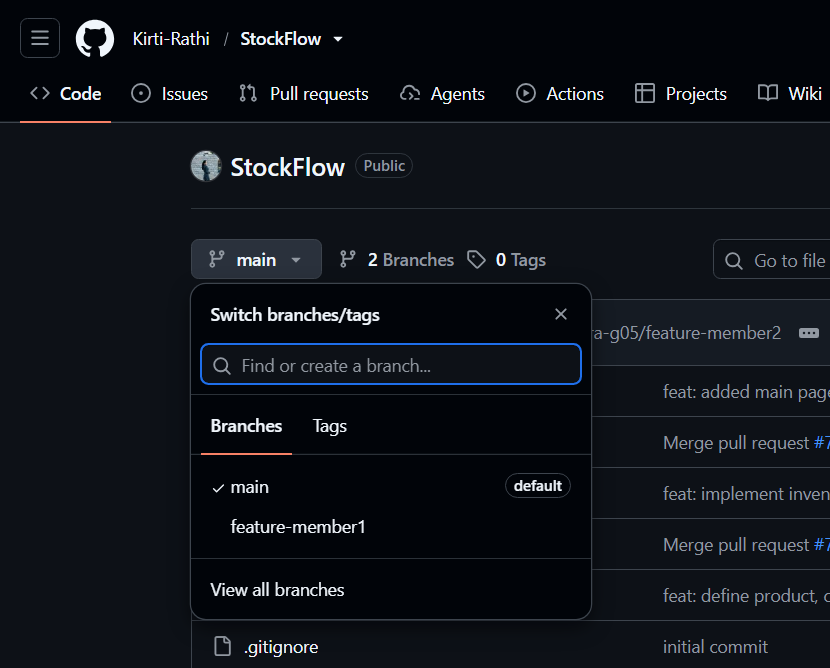
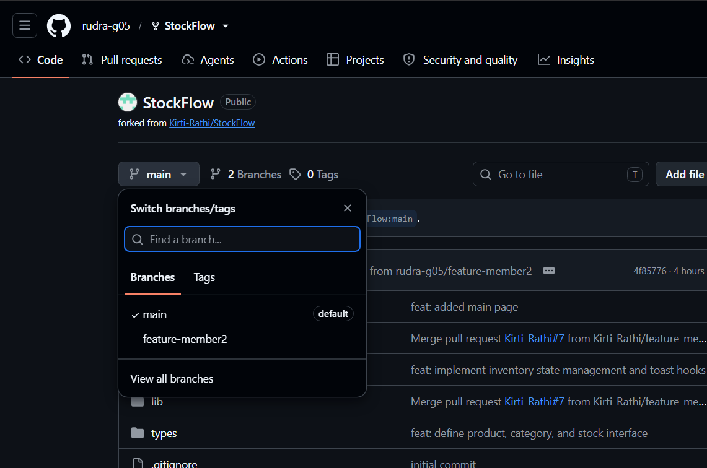
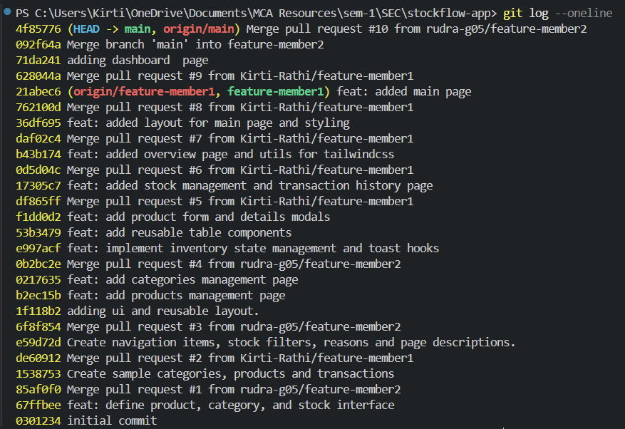
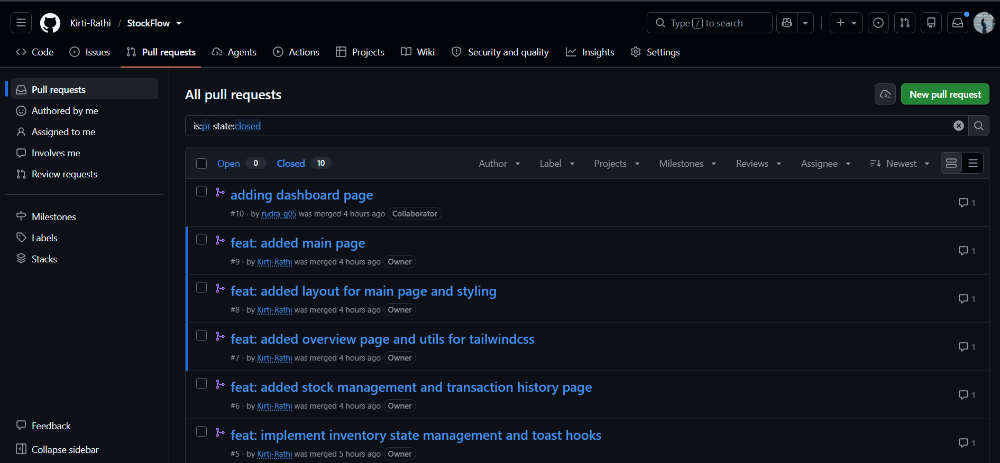
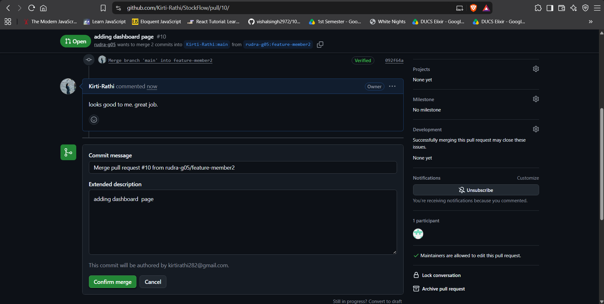
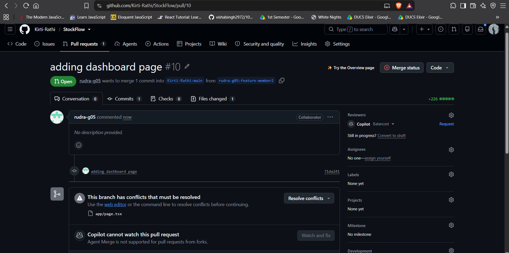
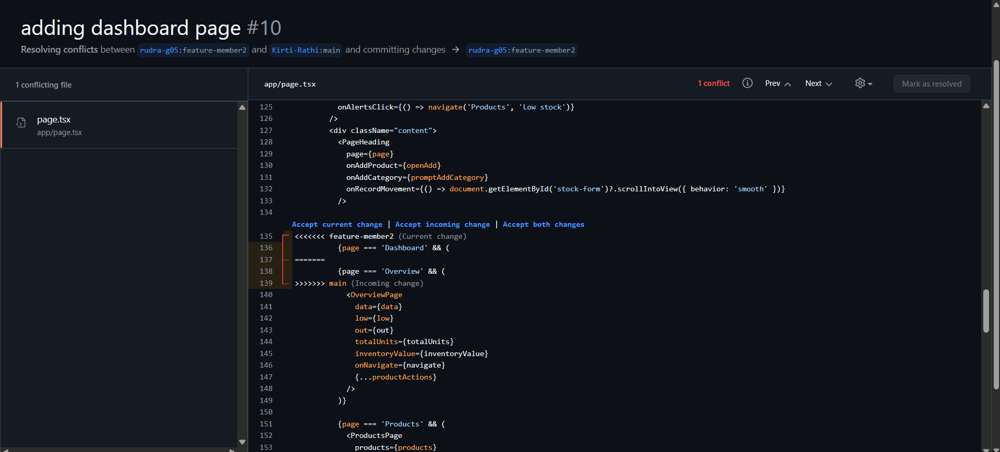
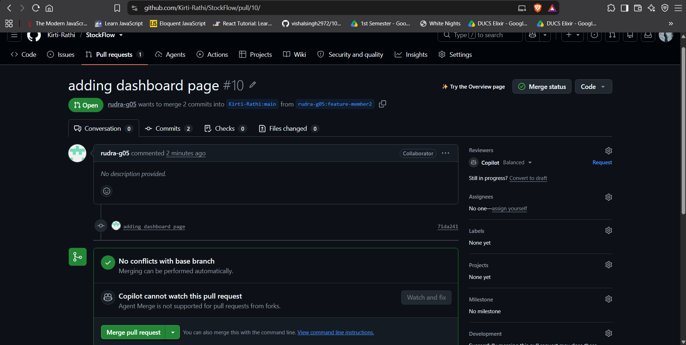

# Project Contributions and Collaboration – StockFlow

## 1. Introduction

StockFlow is an inventory management system developed collaboratively by [Kirti Rathi](https://github.com/kirti-rathi) and [Rudra Gupta](https://github.com/rudra-g05)

The project involved collaborative software development using Git for version control and GitHub for repository hosting, branching, pull requests, code reviews, and merge conflict resolution.

**Project Links:**

- **Original Repository:** [Kirti-Rathi/StockFlow](https://github.com/Kirti-Rathi/StockFlow)
- **Contributor's Fork:** [rudra-g05/StockFlow](https://github.com/rudra-g05/StockFlow)
- **Live Application:** [StockFlow](https://stockflow-sec.vercel.app/)

## 2. Team Members and Individual Contributions

The project was developed by two contributors. Both members worked on separate components and integrated their contributions through pull requests.

### 2.1 Kirti Rathi

**GitHub:** [@Kirti-Rathi](https://github.com/Kirti-Rathi)

**Repository:** [Kirti-Rathi/StockFlow](https://github.com/Kirti-Rathi/StockFlow)

Kirti maintained the original repository and contributed to the application's inventory functionality, data management, and interface integration.

**Major Contributions:**

1. Created sample categories, products, and transactions.
2. Implemented inventory state management and reusable toast hooks.
3. Developed product forms, product details modals, and reusable tables.
4. Implemented stock management and transaction history pages.
5. Developed the overview page and utility functions.
6. Implemented the main application layout and styling.
7. Integrated the main application page.

### 2.2 Rudra Gupta

**GitHub:** [@rudra-g05](https://github.com/rudra-g05)

**Repository:** [rudra-g05/StockFlow](https://github.com/rudra-g05/StockFlow)

Rudra contributed to the application's foundational structure, reusable components, navigation, and interface development through a fork of the original repository.

**Major Contributions:**

1. Defined TypeScript interfaces for products, categories, and stock.
2. Created navigation items, stock filters, transaction reasons, and page descriptions.
3. Developed reusable layout components, including the sidebar, topbar, and page heading.
4. Implemented product and category page components.
5. Developed the reusable toast interface.
6. Submitted a pull request titled "adding dashboard page".

## 3. Branching Strategy

We followed a **feature-based branching strategy** to keep the contributions of both team members separate from the main development branch.

The original repository was maintained by Kirti, while Rudra worked through a fork of the original repository.

The following branches were used:

| Branch | Contributor / Purpose |
|---|---|
| `main` | Central branch containing the integrated project |
| `feature-member1` | Kirti Rathi |
| `feature-member2` | Rudra Gupta |

### Kirti's Branch

### Rudra's Branch

### Collaboration Workflow

1. Kirti created and maintained the original repository.
2. Rudra forked the original repository into his GitHub account.
3. Both contributors worked on their respective feature branches.
4. Changes were committed and pushed to their respective repositories.
5. Rudra occasionally synchronized his fork with the original repository to incorporate the latest changes.
6. Both contributors submitted pull requests targeting the original repository's `main` branch.
7. The other contributor reviewed and tested the proposed changes.
8. After review, the changes were merged into `main`.

## 4. Commit History

Individual commits were used to record the implementation of features and modifications throughout development. The commit history provides a chronological record of the work performed by both contributors.

The following table lists the development commits separately from the pull request history.

### 4.1 Kirti Rathi – Commits

| S. No. | Commit hash | Commit Message |
|---|---|---|
| 1. | [0301234](https://github.com/Kirti-Rathi/StockFlow/commit/03012349bb97cc9047edf3cfde882711b214b311) | initial commit |
| 2. | [1538753](https://github.com/Kirti-Rathi/StockFlow/commit/153875332de50ea9810bf05e969a646477cf1f12) | Create sample categories, products and transactions |
| 3. | [e997acf](https://github.com/Kirti-Rathi/StockFlow/commit/e997acf8bad95c15f16fab41116641bf84ce3748) | feat: implement inventory state management and toast hooks |
| 4. | [53b3479](https://github.com/Kirti-Rathi/StockFlow/commit/53b3479b2efb3ef61367735a686cb915ceed5fbc) | feat: add reusable table components |
| 5. | [f1dd0d2](https://github.com/Kirti-Rathi/StockFlow/commit/f1dd0d204472cc9f6166e7d6c8be3e70f60007d5) | feat: add product form and details modals |
| 6. | [17305c7](https://github.com/Kirti-Rathi/StockFlow/commit/17305c7f9c7d959daf5555ea12dde30c869dbbde) | feat: added stock management and transaction history page |
| 7. | [b43b174](https://github.com/Kirti-Rathi/StockFlow/commit/b43b17431f955848340fba6ccc054fdb31131b6f) | feat: added overview page and utils for tailwindcss |
| 8. | [36df695](https://github.com/Kirti-Rathi/StockFlow/commit/36df695c51551f3ab740b0c4bb18e9a352eac271) | feat: added layout for main page and styling |
| 9. | [21abec6](https://github.com/Kirti-Rathi/StockFlow/commit/21abec6a6c4e10e71e9c28b9025f37a389e41f21) | feat: added main page |

### 4.2 Rudra Gupta – Commits

| S. No. | Commit hash | Commit Message |
|---|---|---|
| 1. | [67ffbee](https://github.com/Kirti-Rathi/StockFlow/commit/67ffbeeaa111838740932ea0ab2ac6671cd6ff47) | feat: define product, category, and stock interface |
| 2. | [e59d72d](https://github.com/Kirti-Rathi/StockFlow/commit/e59d72d890ca13c1bd8b18f5d90964e97b037908) | Create navigation items, stock filters, reasons and page descriptions. |
| 3. | [1f118b2](https://github.com/Kirti-Rathi/StockFlow/commit/1f118b240c527682fb958097eb8cff4b4e029063) | adding ui and reusable layout. |
| 4. | [b2ec15b](https://github.com/Kirti-Rathi/StockFlow/commit/b2ec15b95e4819e33ba30bfdb15a4596594f3c48) | feat: add products management page |
| 5. | [0217635](https://github.com/Kirti-Rathi/StockFlow/commit/0217635f78bff11fba82ba0dd5ee4bf323960319) | feat: add categories management page |
| 6. | [71da241](https://github.com/Kirti-Rathi/StockFlow/commit/71da241ebff730a978f4903c0e7630e32bbccf0c) | adding dashboard page |

### 4.3 Synchronization and Conflict-Resolution Commit

| S. No. | Commit hash | Description |
|---|---|---|
| 1. | [092f64a](https://github.com/Kirti-Rathi/StockFlow/commit/092f64a2132d612d0412c55dd827d2e99e0b9725) | Merge branch `main` into `feature-member2` |

This commit records the synchronization of the original `main` branch into Rudra's feature branch during the final integration process.

The commit history also contains GitHub-generated merge commits for the pull requests. Those integration commits are distinct from the individual development commits listed above.

**Complete Commit History:** [View commits on GitHub](https://github.com/Kirti-Rathi/StockFlow/commits/main/)

## 5. Pull Requests and Merging

Pull requests were used to integrate individual contributions into the original repository.

Both contributors created pull requests from their respective feature branches, with `main` as the target branch.

### Pull Request Summary

| PR | Author | Description | Status |
|---|---|---|---|
| [#1](https://github.com/Kirti-Rathi/StockFlow/pull/1) | Rudra | Product, category, and stock interfaces | Merged |
| [#2](https://github.com/Kirti-Rathi/StockFlow/pull/2) | Kirti | Sample categories, products, and transactions | Merged |
| [#3](https://github.com/Kirti-Rathi/StockFlow/pull/3) | Rudra | Navigation and inventory constants | Merged |
| [#4](https://github.com/Kirti-Rathi/StockFlow/pull/4) | Rudra | Reusable UI and layout | Merged |
| [#5](https://github.com/Kirti-Rathi/StockFlow/pull/5) | Kirti | Inventory state management and toast hooks | Merged |
| [#6](https://github.com/Kirti-Rathi/StockFlow/pull/6) | Kirti | Stock management and transaction history | Merged |
| [#7](https://github.com/Kirti-Rathi/StockFlow/pull/7) | Kirti | Overview page and utilities | Merged |
| [#8](https://github.com/Kirti-Rathi/StockFlow/pull/8) | Kirti | Main page layout and styling | Merged |
| [#9](https://github.com/Kirti-Rathi/StockFlow/pull/9) | Kirti | Main application page | Merged |
| [#10](https://github.com/Kirti-Rathi/StockFlow/pull/10) | Rudra | Dashboard page (PR title) | Merged |

**Total pull requests: 10**

All ten pull requests were merged into the original repository's `main` branch.

The pull request history demonstrates how individual contributions were submitted, reviewed, and integrated into the shared project.

## 6. Code Review Process

Code reviews were performed collaboratively by both contributors.

Each contributor reviewed the other member's pull requests before they were merged into the main branch.

The review process involved:

1. Examining the modified files and proposed code changes.
2. Checking the implementation of the proposed functionality.
3. Testing the changes to verify that the functionality worked as expected.
4. Providing feedback through pull request discussions.
5. Confirming the changes before merging.

### Examples of Peer Review Feedback

| Pull Request | Reviewer | Review Comment |
|---|---|---|
| [PR #4](https://github.com/Kirti-Rathi/StockFlow/pull/4) | Kirti | "looks good to me" |
| [PR #5](https://github.com/Kirti-Rathi/StockFlow/pull/5) | Rudra | "works well" |
| [PR #6](https://github.com/Kirti-Rathi/StockFlow/pull/6) | Rudra | "looks good" |
| [PR #7](https://github.com/Kirti-Rathi/StockFlow/pull/7) | Rudra | "It's nice" |
| [PR #8](https://github.com/Kirti-Rathi/StockFlow/pull/8) | Rudra | "okay." |
| [PR #9](https://github.com/Kirti-Rathi/StockFlow/pull/9) | Rudra | "works well" |
| [PR #10](https://github.com/Kirti-Rathi/StockFlow/pull/10) | Kirti | "looks good to me. great job." |

These discussions reflect the exchange of feedback and collaborative verification carried out during development.

The recorded feedback was provided through pull request conversation comments rather than formal GitHub review submissions.

<!-- Insert screenshots of selected pull request discussions showing feedback from both contributors. -->

## 7. Merge Conflict Resolution

During the integration of changes in **Pull Request #10**, we encountered a merge conflict.

The conflict arose while integrating changes from different branches into the original repository.

The conflicting changes were examined and reconciled. The resolved code was then verified, and the pull request was successfully merged.

This demonstrated the importance of synchronizing branches, understanding conflicting changes, and verifying the final integrated code during collaborative development.

**Evidence of Conflict:**

**Conflict in file**

**Evidence of Resolution:**

## 8. Summary

StockFlow was developed through collaborative version control using Git and GitHub.

The project involved:

- Two contributors with distinct individual responsibilities.
- A fork-based collaboration model.
- Separate feature branches for parallel development.
- Individual commits documenting development progress.
- Ten pull requests merged into the original repository.
- Mutual code reviews and functionality testing.
- Resolution of a merge conflict during PR #10.

The collaboration provided practical experience with repository management, branching, version control, pull request-based integration, peer reviews, and merge conflict resolution.

---

**Project:** StockFlow  
**Contributors:** Kirti Rathi and Rudra Gupta  
**Original Repository:** [Kirti-Rathi/StockFlow](https://github.com/Kirti-Rathi/StockFlow)