# StockFlow — Real-Time Inventory & Stock Movement System

<p align="center">
  
  
  
  
  
  
</p>

---

## 📌 Quick Links

- 🌐 **Live Web Application:** [stockflow-sec.vercel.app](https://stockflow-sec.vercel.app/)
- 📦 **Original Repository (Upstream):** [Kirti-Rathi/stockflow](https://github.com/Kirti-Rathi/stockflow)
- 🔀 **Contributor Fork:** [rudra-g05/StockFlow](https://github.com/rudra-g05/StockFlow)
- 🤝 **Collaboration Documentation:** [CONTRIBUTING.md](CONTRIBUTING.md)

---

## 📖 Project Overview & Description

**StockFlow** is a modern, real-time inventory tracking and stock movement management application designed for streamlined catalog supervision, real-time replenishment tracking, and auditable transaction recording. Built with **Next.js (App Router)**, **React 19**, and **TypeScript**, StockFlow pairs a high-performance client state architecture with an editorial dark-aesthetic user interface styled with **Tailwind CSS**.

StockFlow delivers end-to-end visibility across product categories, stock distribution, low-stock thresholds, and inbound/outbound material transfers. Designed for operational clarity, it replaces fragmented spreadsheets and manual ledgers with an interactive, auditable, and responsive dashboard.

Developed as a collaborative project for **SEC101: Software Tools and Techniques, MCA Semester-1**, the repository serves both as a functional inventory tool and as a benchmark for enterprise-grade collaborative Git workflows—including feature-branch isolation, pull request peer reviews, and conflict reconciliation.

---

## 🎯 Project Objectives

| Dimension | Primary Objective |
|---|---|
| **Inventory Precision** | Maintain an accurate, real-time registry of SKUs, categories, quantities, unit prices, and valuation. |
| **Proactive Replenishment** | Automatically flag low-stock items (quantity $\le$ minStock) and out-of-stock items with visual cues. |
| **Complete Auditability** | Log every stock adjustment (Stock In / Stock Out) with timestamps, quantity delta, prior/updated stock, and operational reasons. |
| **User Experience** | Provide a distraction-free, high-contrast dark editorial interface with instant client-side updates and zero latency. |
| **Collaborative Engineering** | Implement an industry-standard Git collaboration framework (fork-and-branch model, peer code reviews, branch synchronization, and conflict resolution). |

---

## 👥 Team Members & Contributions

StockFlow was built collaboratively by a two-member team using a structured fork-and-branch workflow on GitHub.

### 👤 Member 1: Kirti Rathi *(Project Lead & Upstream Maintainer)*
- **GitHub:** [@Kirti-Rathi](https://github.com/Kirti-Rathi)
- **Repository:** [Kirti-Rathi/stockflow](https://github.com/Kirti-Rathi/stockflow)
- **Role & Key Contributions:**
  1. **Upstream Repository Maintenance:** Established the repository architecture, initial branch rules, and managed integration of all incoming pull requests.
  2. **Inventory Core State Engine:** Built the `useInventory` custom hook powering reactive state, localStorage synchronization, validations, and auto-generated transaction records.
  3. **Data Seeding & Mock Models:** Created realistic seed dataset (`lib/seed.ts`) covering multi-category products, initial quantities, and historical transactions.
  4. **Stock Operations Interface:** Engineered the `StockPage` component supporting dual-mode Stock In (Purchase, Return, Initial Stock) and Stock Out (Sale, Internal Use, Damaged) operations with real-time before/after previews.
  5. **Overview Analytics Dashboard:** Developed `OverviewPage` containing real-time KPI metric cards, dynamic CSS conic-gradient donut chart for category distribution, health-check status bars, and the Replenishment Queue.
  6. **Interactive Tables & Modals:** Developed reusable `ProductTable`, `TransactionTable`, `ProductFormModal`, and `ProductDetailsModal` with comprehensive editing and viewing capabilities.
  7. **Main Application Shell:** Integrated navigation state, modal lifecycle, and application layout in `app/page.tsx`.

### 👤 Member 2: Rudra Gupta *(Core Contributor)*
- **GitHub:** [@rudra-g05](https://github.com/rudra-g05)
- **Repository (Fork):** [rudra-g05/StockFlow](https://github.com/rudra-g05/StockFlow)
- **Role & Key Contributions:**
  1. **Domain Model & Type Definitions:** Authored strict TypeScript contracts (`types/inventory.ts`) for `Product`, `Category`, `Transaction`, `StockType`, and `StockFilter`.
  2. **Navigation & Constants Framework:** Structured `lib/constants.ts` with navigation schemas, Lucide icon bindings, page descriptions, filter types, and stock movement reasons.
  3. **Reusable Layout System:** Engineered high-level layout primitives including `Sidebar` (collapsible, badge-aware, active indicator), `Topbar` (breadcrumbs, global search bar, date stamps), and `PageHeading`.
  4. **Catalog & Category Management:** Created the `ProductsPage` with multi-tier search and filtering, and the `CategoriesPage` with SKU aggregation, card-based category metrics, and quick actions.
  5. **Notification UI:** Developed the floating `Toast` notification primitive for user feedback during CRUD and stock operations.
  6. **Fork Synchronization & Merge Integration:** Authored PRs [#1, #3, #4, #10], conducted peer code reviews on upstream pull requests, and performed upstream sync/conflict resolution.

### 📊 Contribution Matrix

```
┌───────────────────────────────────────┬───────────────────┬───────────────────┐
│ Feature / Responsibility              │ Kirti Rathi       │ Rudra Gupta       │
├───────────────────────────────────────┼───────────────────┼───────────────────┤
│ Upstream Repo Management & Deployment │ Lead (Owner)      │ Fork Contributor  │
│ TypeScript Types & Interfaces         │ Reviewer          │ Primary Author    │
│ App Layout, Sidebar & Topbar UI       │ Integration       │ Primary Author    │
│ Inventory State Engine & Hooks        │ Primary Author    │ Reviewer          │
│ Data Seeding & Mock Store             │ Primary Author    │ Reviewer          │
│ Overview Dashboard & Visual Charts    │ Primary Author    │ Reviewer          │
│ Products & Categories Pages           │ Reviewer          │ Primary Author    │
│ Stock In / Stock Out Management       │ Primary Author    │ Reviewer          │
│ Reusable Tables & Modals              │ Primary Author    │ Reviewer          │
│ Toast Notification System             │ Hook Author       │ UI Author         │
│ Merge Conflict Reconciliation (PR #10)│ Reviewer / Merger │ Resolving Committer│
└───────────────────────────────────────┴───────────────────┴───────────────────┘
```

> 💡 **For full commit hashes, review logs, and pull request histories, refer to [CONTRIBUTING.md](CONTRIBUTING.md).**

---

## ✨ Features

### 1. 📊 Live Dashboard & Analytics (Overview)
- **Real-Time KPIs:** Live metric cards showing Total Products, Total Units In Stock, Low Stock items, Out of Stock items, and total cumulative Inventory Valuation in Indian Rupees (₹).
- **Category Donut Visualization:** Dynamic conic-gradient chart rendering inventory proportions across all categories.
- **Stock Health Check:** Multi-column bar gauge depicting healthy stock vs. low stock vs. stockouts.
- **Replenishment Queue:** Instant prioritized feed of items below safe threshold limits.
- **Latest Transaction Strip:** Quick glance at the most recent stock receipts and shipments.

### 2. 📦 Comprehensive Product Catalog Management
- **CRUD Operations:** Create new products, view deep SKU specifications, edit existing details, and safely delete items (with historical transaction retention).
- **Threshold Rules:** Custom `minStock` threshold per SKU to trigger automatic alerts.
- **Dynamic Search & Filtering:** Filter products simultaneously by search keyword (name or SKU ID), stock condition (*All stock*, *In stock*, *Low stock*, *Out of stock*), and category dropdown.
- **Real-time Catalog Metrics:** Header summary calculating matched products and total matching valuation on the fly.

### 3. 🏷️ Categorization & Grouping
- **Visual Category Cards:** Dedicated cards with custom themed badge icons displaying assigned product count, total physical units, and total inventory worth.
- **Category Operations:** Add new product categories, rename existing categories, or delete unneeded groups.
- **Cross-Navigation:** One-click navigation from any category card directly to its filtered products table.

### 4. 🔄 Inbound & Outbound Stock Operations
- **Stock IN (Receiving):** Log inbound supplies under operational reasons: *Purchase*, *Return*, *Initial Stock*, or *Other*.
- **Stock OUT (Issuing):** Issue inventory with validations against stockouts: *Sale*, *Internal Use*, *Damaged*, or *Other*.
- **Live Stock Delta Preview:** Visual calculation showing existing stock, delta, and anticipated final stock before recording the transaction.

### 5. 📜 Transaction Audit Trail & History
- **Immutable Log:** Every stock adjustment automatically appends an unalterable transaction record.
- **Detailed Audit Attributes:** Transaction ID, product name, movement type badge, quantity transferred, previous stock, updated stock, operational reason, and exact timestamp.
- **Transaction Analytics:** Top metrics tracking Total Transactions, Units Received, Units Issued, and movements recorded Today.

### 6. 🎨 High-Performance Dark Editorial UI
- **Typography & Aesthetics:** Curated palette featuring deep obsidian backgrounds (`#090909`), crisp typography, lime green accents (`#d7ff4f`), and subtle borders.
- **Fully Responsive:** Collapsible sliding sidebar and adaptive layout for desktop, tablet, and mobile browsers.
- **Zero-Latency State:** Instant UI updates powered by React hooks and persistent `localStorage` synchronization.

---

## 🛠️ Technology Stack

| Category | Technology / Library | Version | Purpose |
|---|---|---|---|
| **Framework** | [Next.js (App Router)](https://nextjs.org/) | `16.4.3` | React production framework, routing, and SSR |
| **UI Library** | [React](https://react.dev/) | `^19.0.0` | Declarative component UI engine |
| **Language** | [TypeScript](https://www.typescriptlang.org/) | `5.7.3` | Type safety and domain contracts |
| **Styling** | [Tailwind CSS](https://tailwindcss.com/) | `^4.3.3` | Utility-first CSS framework |
| **Animations** | `tw-animate-css` | `^1.4.0` | Fluid CSS transitions and modal animations |
| **Primitives** | `@base-ui/react` / `shadcn` | `^1.5.0` | Accessible component primitives and design tokens |
| **Icons** | [Lucide React](https://lucide.dev/) | `^1.16.0` | Clean vector iconography across all views |
| **Analytics** | `@vercel/analytics` | `1.6.1` | Real-time web vitals and usage analytics |
| **Package Manager**| [pnpm](https://pnpm.io/) | `12.3.4` | Fast, disk-space-efficient package manager |
| **Deployment** | [Vercel](https://vercel.com/) | Cloud | Continuous deployment & edge network hosting |

---

## 📁 Project Structure

```text
stockflow-app/
├── app/
│   ├── globals.css              # Custom design system, CSS variables, dark theme & typography
│   ├── layout.tsx               # Root application layout and Vercel Analytics integration
│   └── page.tsx                 # Master page coordinating navigation, modals, and views
├── assets/                      # Git workflow screenshots, collaboration logs, conflict proofs
│   ├── commit-history.png       # GitHub commit history screenshot
│   ├── conflict-lines.png       # Code-level merge conflict screenshot
│   ├── kirti-branch.png         # Feature branch demonstration (Member 1)
│   ├── merge-conflict.png       # Pull request merge conflict notification
│   ├── merged-pr.png            # Successful pull request merge confirmation
│   ├── open-pr.png              # Open pull request submission
│   ├── pr-comment.png           # Peer code review discussion thread
│   ├── pr.png                   # Repository pull requests overview
│   ├── resolved-conflict.png    # Reconciled code resolution screenshot
│   └── rudra-branch.png         # Feature branch demonstration (Member 2)
├── components/
│   ├── layout/                  # Shell and persistent UI chrome
│   │   ├── PageHeading.tsx      # Page header with title, subtitle, and primary actions
│   │   ├── Sidebar.tsx          # Collapsible navigation drawer with health indicators
│   │   └── Topbar.tsx           # Breadcrumbs, search input, notification icon, date stamp
│   ├── modals/                  # Interactive overlay dialogs
│   │   ├── ProductDetailsModal.tsx # Full product specification inspection modal
│   │   └── ProductFormModal.tsx    # Modal form for adding or editing products
│   ├── pages/                   # Main view components
│   │   ├── CategoriesPage.tsx   # Category metrics cards and management
│   │   ├── OverviewPage.tsx     # Executive analytics dashboard and replenishment queue
│   │   ├── ProductsPage.tsx     # Filterable product catalog table
│   │   ├── StockPage.tsx        # Stock IN / Stock OUT transaction engine
│   │   └── TransactionsPage.tsx # Chronological transaction history and audit log
│   ├── tables/                  # Reusable data table components
│   │   ├── ProductTable.tsx     # Product listing with status tags, stock, and action buttons
│   │   └── TransactionTable.tsx # Transaction history records with color-coded badges
│   └── ui/
│       └── Toast.tsx            # Floating toast notification popup
├── hooks/
│   ├── useInventory.ts          # Core state management, CRUD, localStorage persistence
│   └── useToast.ts              # Custom notification queue and dismiss timer
├── lib/
│   ├── constants.ts             # Navigation schemas, reason enums, page meta
│   ├── inventory.ts             # Helper math (valuation, donut gradient, stock status)
│   ├── seed.ts                  # Mock data for products, categories, transactions
│   └── utils.ts                 # Classname merging and Tailwind utilities
├── types/
│   └── inventory.ts             # TypeScript domain schemas and interfaces
├── CONTRIBUTING.md              # Detailed Git collaboration, PRs, review & conflict report
├── package.json                 # Dependency definitions and scripts
├── tsconfig.json                # TypeScript compiler configuration
└── README.md                    # Project documentation (this file)
```

---

## 📸 Application Screenshots & Live Output

> 🔗 **Explore live directly at:** [https://stockflow-sec.vercel.app/](https://stockflow-sec.vercel.app/)

### 1. 📊 Executive Overview Dashboard
*Live KPI cards, visual inventory breakdown by category, health bar chart, replenishment queue, and recent activities.*

 
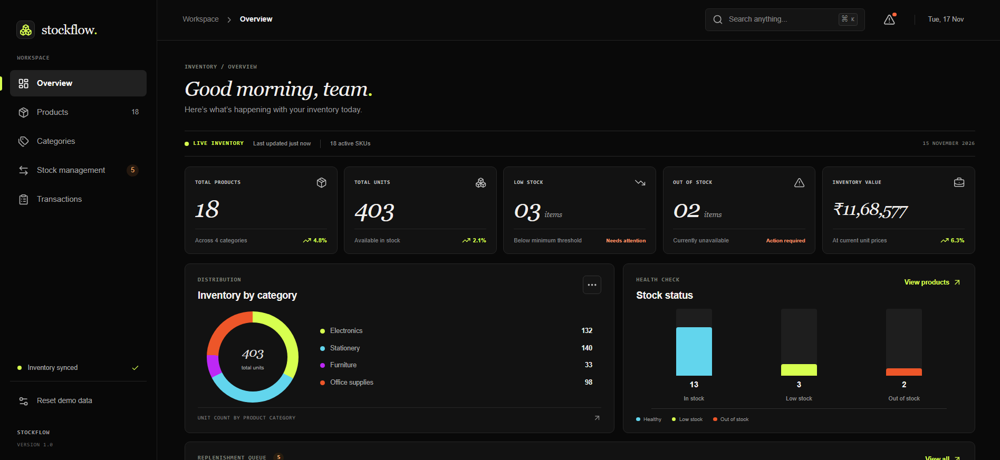


---

### 2. 📦 Products Catalog & Filter System
*Filterable catalog with multi-field search, status badges (`In stock`, `Low stock`, `Out of stock`), and quick action buttons.*

 
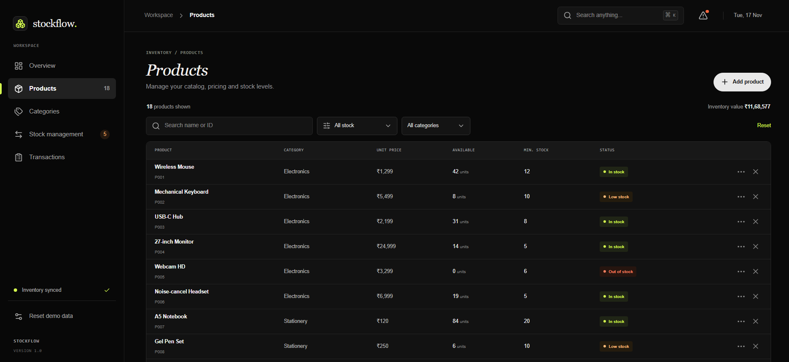

---

### 3. 📂 Category management
*Organized category management system to create, update, and manage product categories, ensuring better inventory classification and easy product organization.*

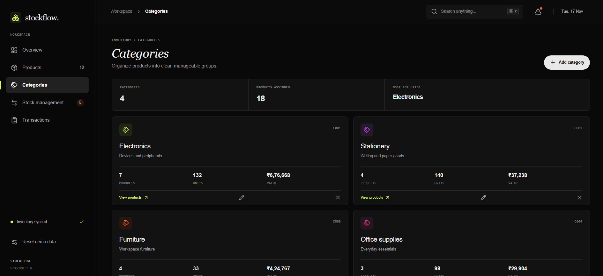

---

### 4. 🔄 Stock Movement Management (Stock In / Stock Out)
*Intuitive operational form to receive or issue inventory with real-time stock preview and automatic transaction generation.*

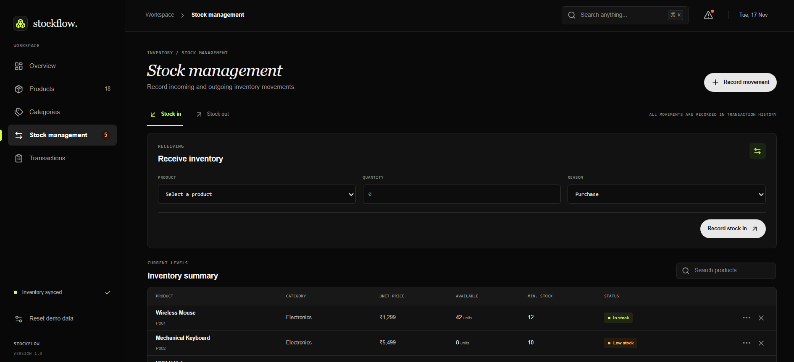

---

### 5. 📜 Complete Audit Trail & Transactions History
*Immutable chronological log tracking every stock addition, dispatch, and adjustment.*
 
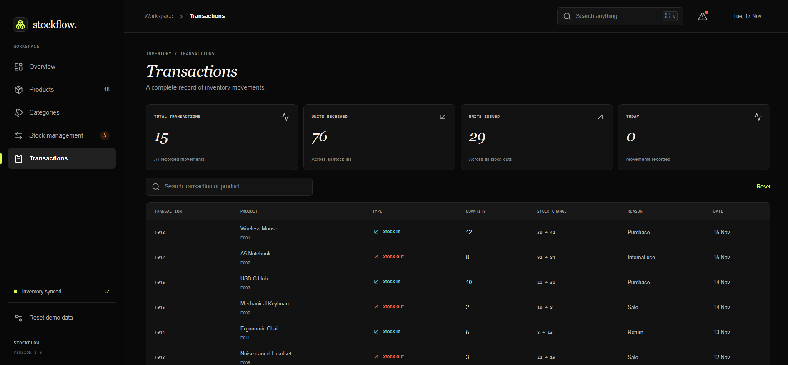

---

## 🔀 Git Collaboration & Branching Strategy

The team followed a strict **Git Feature Branching Workflow** combined with GitHub's fork model:

```
[Upstream: Kirti-Rathi/StockFlow]
     main ──●────────────────●───────●───────● (PR #10 Merged)
            │                ↑       ↑       ↑
            │  Pull Requests │       │       │
[Branches]  ├── feature-member1 ─────┘       │
            │   (Kirti Rathi)                │
            │                                │
            └── [Fork: rudra-g05/StockFlow]  │
                     feature-member2 ────────┘
                     (Rudra Gupta)
```

### Collaboration Artifacts from Development

| Workflow Phase | Evidence / Screenshot |
|---|---|
| **Branch Isolation (Kirti)** | 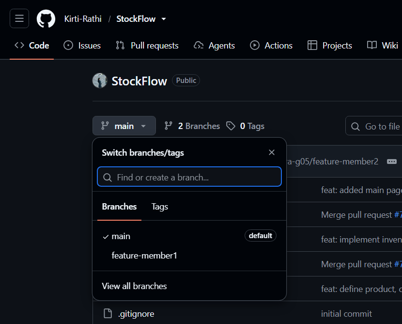 |
| **Branch Isolation (Rudra)** | 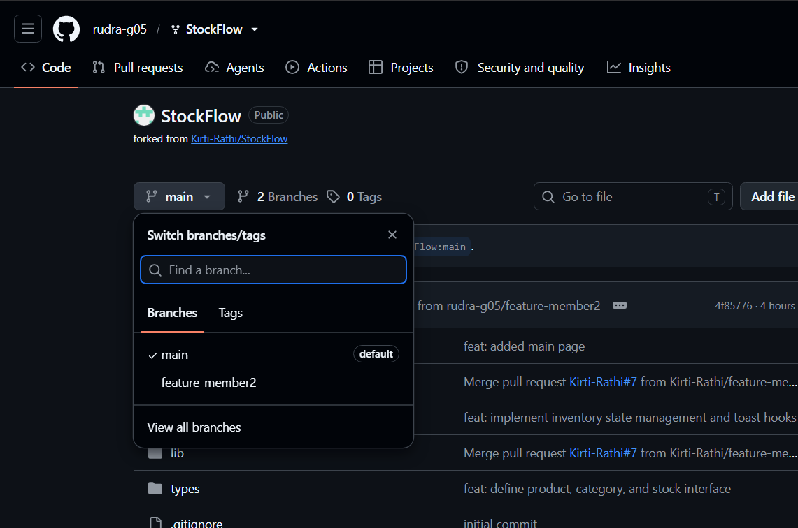 |
| **Pull Request Reviews** | 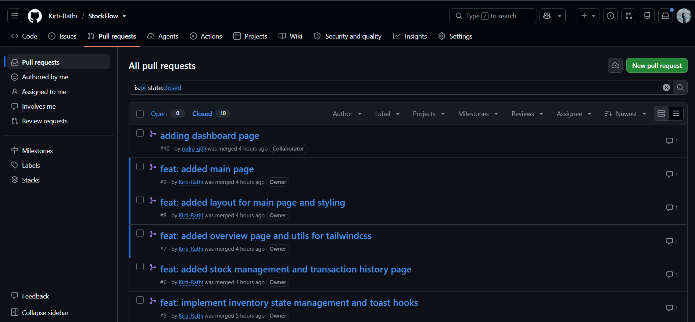 |
| **Peer Review Comments** | 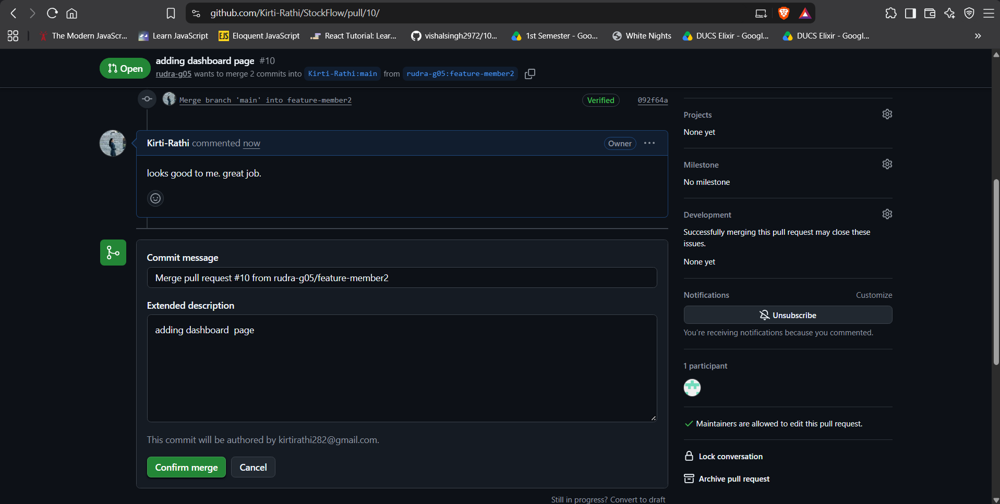 |
| **Merge Conflict Encountered** | 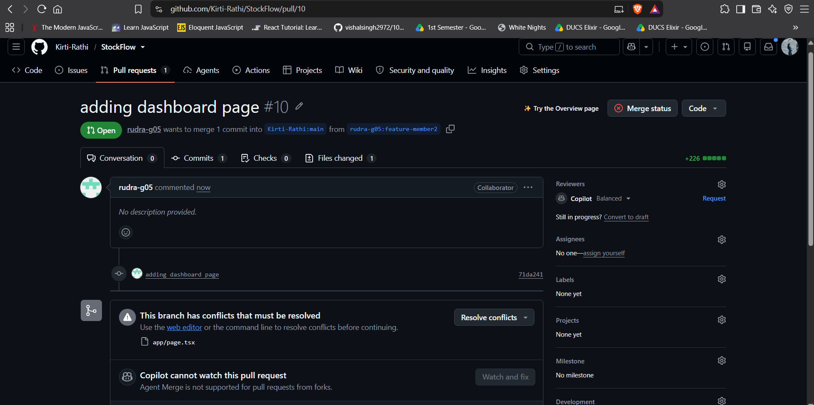 |
| **Conflict Code Lines** | 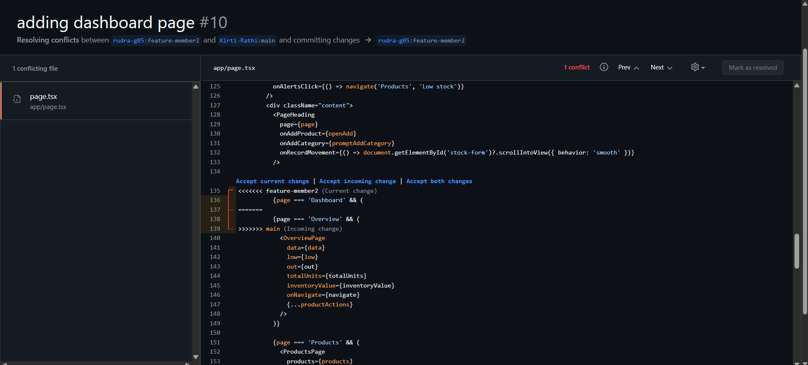 |
| **Successful Resolution** | 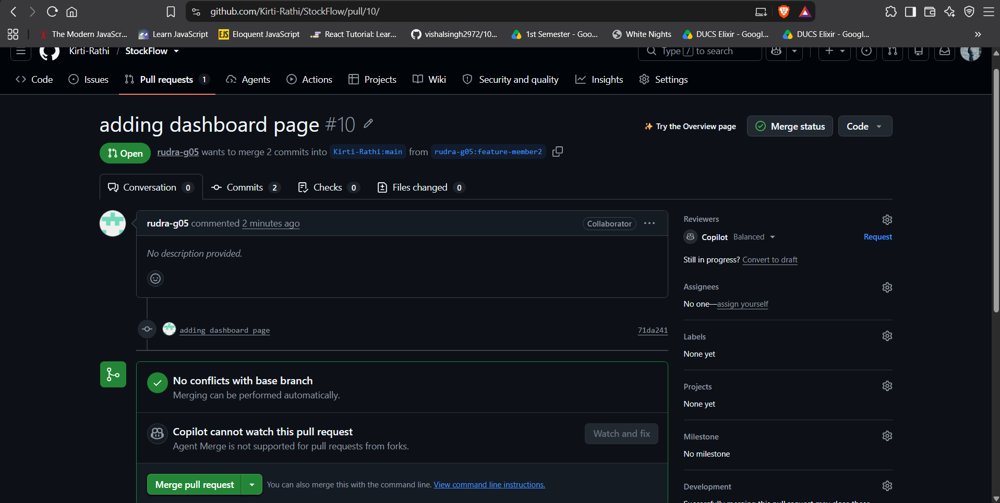 |
| **Verified Commit History** | 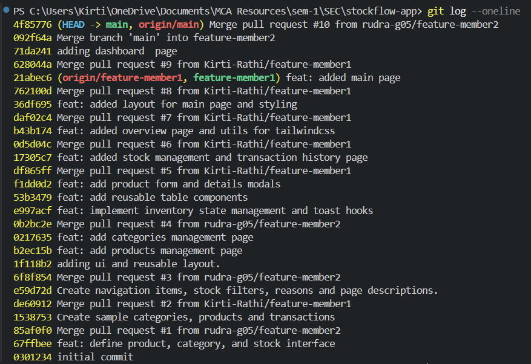 |

---

## 🚀 Installation & Execution Guide

Follow these steps to run StockFlow locally on your development machine.

### 1. Prerequisites
Ensure you have the following installed:
- [Node.js](https://nodejs.org/) (`v18.17.0` or higher; recommended `v20+`)
- [pnpm](https://pnpm.io/) (`v9+` or `v12+`) or `npm` / `yarn`
- [Git](https://git-scm.com/)

```bash
# Verify your node and package manager versions
node -v
pnpm -v # or npm -v
```

---

### 2. Clone the Repository

You can clone either the original upstream repository or the contributor fork:

```bash
# Option A: Clone the Original Upstream Repository (Kirti Rathi)
git clone https://github.com/Kirti-Rathi/stockflow.git
cd stockflow

# Option B: Clone the Contributor Fork (Rudra Gupta)
git clone https://github.com/rudra-g05/StockFlow.git
cd StockFlow
```

---

### 3. Install Dependencies

Install the project dependencies using `pnpm` (recommended) or `npm`:

```bash
# Using pnpm (recommended)
pnpm install

# Alternatively, using npm
npm install
```

---

### 4. Run the Development Server

Start the local development server:

```bash
# Using pnpm
pnpm dev

# Alternatively, using npm
npm run dev
```

Open [http://localhost:3000](http://localhost:3000) in your web browser. The application will automatically reload if you edit any files.

---

### 5. Build for Production

To create an optimized production build:

```bash
# Build production bundle
pnpm build

# Start production server
pnpm start
```

---

### 📋 Available Scripts

| Command | Description |
|---|---|
| `pnpm dev` | Starts the Next.js development server on `http://localhost:3000` |
| `pnpm build` | Compiles and optimizes the application for production deployment |
| `pnpm start` | Boots up the production build locally |

---

## 📐 Data Models & Schema Reference

StockFlow utilizes strictly typed TypeScript domain models:

### Product Schema
```typescript
export type Product = {
  id: string          // Unique identifier, e.g. "P001"
  name: string        // Product title / SKU name
  categoryId: string  // Reference to Category ID, e.g. "C001"
  description: string // Description of the item
  price: number       // Unit selling price in INR (₹)
  quantity: number    // Available units currently in inventory
  minStock: number    // Safe threshold limit (below which triggers alert)
  createdAt: string   // ISO timestamp of SKU creation
}
```

### Stock Transaction Schema
```typescript
export type Transaction = {
  id: string            // Unique transfer ID, e.g. "T048"
  productId: string     // Reference to affected Product ID
  productName: string   // Snapshot of product name
  type: 'STOCK_IN' | 'STOCK_OUT'
  quantity: number      // Units received or dispatched
  previousStock: number // Quantity before transaction
  updatedStock: number  // Quantity after transaction
  reason: string        // Operational reason (e.g. "Purchase", "Sale")
  date: string          // ISO timestamp of operation
}
```

### Stock Threshold Rules
$$\text{Status} = \begin{cases} 
\text{"Out of stock"} & \text{if } \text{quantity} = 0 \\
\text{"Low stock"} & \text{if } 0 < \text{quantity} \le \text{minStock} \\
\text{"In stock"} & \text{if } \text{quantity} > \text{minStock}
\end{cases}$$

---

## 🤝 Contributing

Contributions, feedback, and issue reports are welcome! Please review the comprehensive [CONTRIBUTING.md](CONTRIBUTING.md) guide before submitting any pull requests.

1. Fork the Project.
2. Create your Feature Branch (`git checkout -b feature/NewFeature`).
3. Commit your changes (`git commit -m 'feat: add some NewFeature'`).
4. Push to the Branch (`git push origin feature/NewFeature`).
5. Open a Pull Request targeting `main`.

---

## 📜 License & Academic Attribution

This project was developed for the **Skill Enhancement Course (SEC) — MCA Semester 1**.

- **Repository:** [https://github.com/Kirti-Rathi/stockflow](https://github.com/Kirti-Rathi/stockflow)
- **Live Deployment:** [https://stockflow-sec.vercel.app/](https://stockflow-sec.vercel.app/)
- **Authors:** [Kirti Rathi](https://github.com/Kirti-Rathi) & [Rudra Gupta](https://github.com/rudra-g05)

Released under the **MIT License**. Feel free to use, modify, and distribute this software for educational and personal projects.
